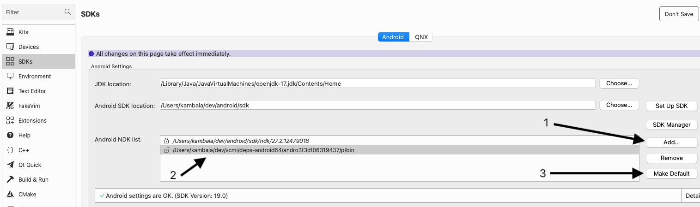
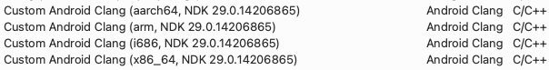
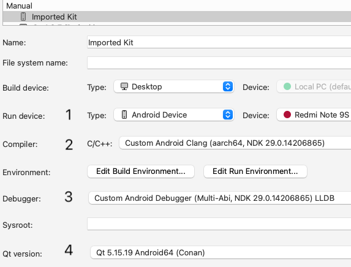
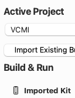
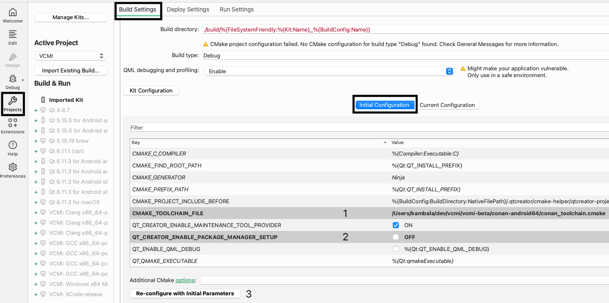
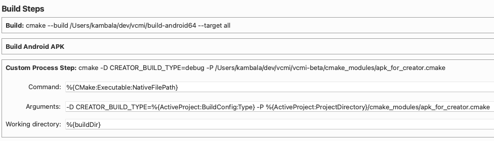
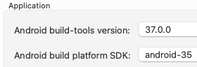
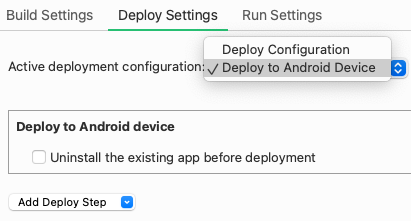

# Building Android

The following instructions apply to **v1.8 and later**. For earlier versions see older Git revision, e.g. from [1.7.5 release](https://github.com/vcmi/vcmi/blob/1.7.5/docs/developers/Building_Android.md).

*Note*: building has been tested only on Linux and macOS. It may or may not work on Windows out of the box.

## Requirements

1. CMake 3.26+: download from your package manager or from <https://cmake.org/download/>
2. JDK 17: any distribution, not necessarily from Oracle
3. Android command line tools or Android Studio for your OS: <https://developer.android.com/studio/>
4. Optional:
    - Ninja: download from your package manager or from <https://github.com/ninja-build/ninja/releases>
    - Ccache: download from your package manager or from <https://github.com/ccache/ccache/releases>

## Obtaining source code

Clone <https://github.com/vcmi/vcmi> with submodules. Example for command line:

```sh
git clone --recurse-submodules https://github.com/vcmi/vcmi.git
```

## Obtaining dependencies

We use Conan package manager to build/consume dependencies, find detailed usage instructions [here](./Conan.md). Note that the link points to the state of the current branch, for the latest release check the same document in the [master branch](https://github.com/vcmi/vcmi/blob/master/docs/developers/Conan.md).

On the step where you need to replace **PROFILE**, choose one of the profiles:

- `android-64-ndk` to build for ARM 64-bit (aarch64-v8a)
- `android-32-ndk` to build for ARM 32-bit (armeabi-v7a)
- `android-x64-ndk` to build for Intel 64-bit (x86_64)

Advanced users may choose profile without `-ndk` suffix to use NDK that's already installed in their system.

### NDK and Conan

Conan must be aware of the NDK location when you execute `conan install`. There're multiple ways to achieve that as written in the [Conan docs](https://docs.conan.io/2/examples/cross_build/android/ndk.html#examples-cross-build-android-ndk):

- the easiest is to download NDK from Conan (option 1 in the docs), then all the magic happens automatically - this is what our aforementioned Conan profiles use, NDK will be downloaded automatically
- to use an already installed NDK, you can simply pass it on the command line to `conan install`: (note that this will likely work only when consuming the prebuilt binaries)

```sh
conan install -c tools.android:ndk_path=/path/to/ndk ...
```

## Build process

Before starting the build, local Gradle configuration must be created (it's a requirement for Qt 5):

```sh
mkdir ~/.gradle
echo "android.bundle.enableUncompressedNativeLibs=true" > ~/.gradle/gradle.properties
```

Building for Android is a 2-step process. First, native C++ code is compiled to a shared library (unlike an executable on other platforms), then Java code is compiled to an actual executable which will be loading the native shared library at runtime.

This is a traditional CMake project, you can build it from command line or some IDE. You're not required to pass any custom options (except Conan toolchain file), defaults are already good.

The Java code (located in the `android` directory of the repo) will be built automatically after the native code using the `androiddeployqt` tool. APK will appear in `<build dir>/android-build/vcmi-app/build/outputs/apk/<build configuration>` directory.

### Building and running in Qt Creator

Using Qt not from the Online Installer (from Conan in our case) requires a bit of IDE setup to be able to build and run a project in Qt Creator.

First, you need to find paths on disk to Qt and NDK. You can do it with our helper script or manually.

#### With the script

Simply run `android/conan_ndk_qt_paths.py` that is in the repo, e.g.:

```sh
python android/conan_ndk_qt_paths.py
```

It will print you all the NDK and Qt packages found in your Conan cache together with their paths, sample output:

```text
NDK list:
r29 - compiler v21.0.0 - 2025-10-08 16:37:42
	/Users/kambala/.conan2/p/andro3f3df06319437/p

Qt list:
5.15.19 for armv8, compiler v21 - 2026-10-15 13:54:37
	/Users/kambala/.conan2/p/qt46b5cdcdb5d90/p
```

*Note 1*: if you installed Conan with `pipx`, then you need to use `$PIPX_HOME/venvs/conan/bin/python` instead of plain `python` to run the script.

*Note 2*: advanced users that use non-default storage path - the `core.cache:storage_path` Conan conf - can pass its value as the script parameter.

#### Manually

You need to use a combination of `conan list` + `conan cache path`:

1. Run `conan list --format=compact --package-query=os=Android "qt/*:*"`
2. From the output copy the line just above `settings:`. There may be more than one entry, then you need to figure out which one you want by looking at the `settings:` line as it lists package's architecture and other *settings* (or just do next step for all the entries). The line you need also contains `:` and doesn't have the date, example:

```text
Found 1 pkg/version recipes matching qt/* in local cache
Local Cache
  qt/5.15.19
    qt/5.15.19#c09b386296e2db74ef51abfd11164b41%1792061677.10175 (2026-10-15 10:54:37 UTC)
      qt/5.15.19#c09b386296e2db74ef51abfd11164b41:2cd7f2703c27be0fc2f099d93f88b8b1a390d0e4
        settings: Android, armv8, Release, clang, 20, c++_shared, 21, 21
```

3. Run `conan cache path "PASTE YOUR COPIED LINE HERE"` - it will output path to the package. For the above sample output the command would be

```sh
conan cache path "qt/5.15.19#c09b386296e2db74ef51abfd11164b41:2cd7f2703c27be0fc2f099d93f88b8b1a390d0e4"
```

4. Now run `conan list --format=compact "android-ndk/*:*"` and do steps 2-3 again to get path to the NDK.

#### Configure Qt Creator

Now that you have NDK and Qt paths, it's time to configure the IDE. The guide is based on Qt Creator v20.0.2, UI may be different in other versions.

1. Open Qt Creator
2. Go to Preferences -> SDKs
3. On the Android tab let Creator install what it wants, in the end it should show *Android settings are OK*
4. Press *Add* to the right of *Android NDK list*
5. Select NDK directory that you obtained from Conan above
6. Select the added NDK in the list and press *Make Default*

7. Go to Preferences -> Kits -> Compilers
8. Ensure that the NDK you've just added is listed there as *Custom Android Clang*

9. Go to *Debuggers* tab
10. Ensure that the NDK you've just added is listed there as *Custom Android Debugger*

11. Go to *Qt Versions* tab
12. Press *Add...* on the right
13. Select Qt directory that you obtained from Conan above
14. Go to *Kits* tab
15. Press *Add* on the right
16. Give it any name you want and configure its properties: *Run device*, *Compiler*, *Debugger*, *Qt version*


#### Configure project

IDE configured, now you can open the project, but it will also require a bit of configuration.

1. Open the project directory or its `CMakeLists.txt` file
2. Select the Kit that you have configured above. If it's not on the main list, you can enable it from the *Build & Run* menu on the left

3. Go to *Projects* (left-side panel) - *Build Settings* - *CMake* - *Initial Configuration*
4. Set `CMAKE_TOOLCHAIN_FILE` property to the toolchain file generated by `conan install` (see [here](./Conan.md#configure-project-for-building))
5. Uncheck `QT_CREATOR_ENABLE_PACKAGE_MANAGER_SETUP` property
6. (optional) Adjust any other things you want, like other CMake properties, build directory etc.
7. Press *Re-configure with Initial Parameters*

8. Scroll down to *Build Steps* section (under the *CMake* section)
9. Press *Add Build Step* - *Custom Process Step* and fill the fields:
    - Command: `%{CMake:Executable:NativeFilePath}`
    - Arguments: `-D CREATOR_BUILD_TYPE=%{ActiveProject:BuildConfig:Type} -P %{ActiveProject:ProjectDirectory}/cmake_modules/apk_for_creator.cmake`
    - Working directory: `%{buildDir}`

10. Expand *Build Android APK* build step that's right above the step you've just added
11. Set *Android build-tools version* to the latest available (should be done by default)
12. Set *Android build platform SDK* to the target SDK you want to compile the app with. Current value that VCMI uses can be found in the root [CMakeLists.txt](../../CMakeLists.txt) in `ANDROID_TARGET_SDK_VERSION` property.

13. Go to *Deploy Settings* tab on top
14. Ensure that *Active deployment configuration* is set to *Deploy to Android Device*


Finally everything's ready to build & run the project. In the bottom left select your Android device (right above the Run button) and press Run or Debug or Build.

After the build Qt Creator may show dialog "Found some build errors in current task. Do you want to ignore them?" even when app was built successfully, so simply press Yes in such case.

*Note*: you may also run CMake configure step in terminal and then open the build directory in Qt Creator. It will generate you a kit that you need to configure as described above in the *Configure Qt Creator* section (or use another working kit of course). You'll also need to go through steps 8-14 of *Configure project*, on step 10 there won't be *Build Android APK* build step and you'd need to add it and place before *Custom Process Step* created on step 9. And if you're using Conan before v2.35, you must also add `ANDROID_ABI` CMake parameter to *Projects* - *Build Settings* - *CMake* - *Initial Configuration*, the value can be found in `conan_toolchain.cmake`, e.g. `arm64-v8a`.

### Building from command line

Requirements:

1. Set `JAVA_HOME` environment variable pointing to your JDK installation
2. Set `ANDROID_HOME` environment variable pointing to your Android SDK installation or pass `-D ANDROID_SDK=...` to the CMake *configure* invocation

- to build just APK (the usual use case): pass `--target build_apk` to the CMake *build* invocation
- to build AAB and APK: pass `--target build_aab` to the CMake *build* invocation
- if you build other targets or not pass `--target` param at all, then only the native C++ code will be built

After building APK you can install it to your device with `adb install -r /path/to/apk` (`adb` command is from Android command line tools - `platform-tools` directory).

### Example

Execute from the root repo directory:

```sh
export JAVA_HOME=/path/to/jdk17
export ANDROID_HOME=/path/to/android/sdk

cmake -S . -B ../build -G Ninja -D CMAKE_BUILD_TYPE=Debug --toolchain ...
cmake --build ../build --target build_apk
```

## Docker

For developing it's also possible to use Docker to build android APK. The only requirement is to have Docker installed. The container image contains all the other prerequisites.

To build using docker just open a terminal with `vcmi` repo root as working directory.

Build the image with (only needed once):

```sh
docker build -f docker/BuildAndroid-aarch64.dockerfile -t vcmi-android-build .
```

After building the image you can compile vcmi with:

```sh
docker run -it --rm -v $PWD/:/vcmi vcmi-android-build
```

The current dockerfile is aarch64 only but can be easily adjusted for other architectures.
