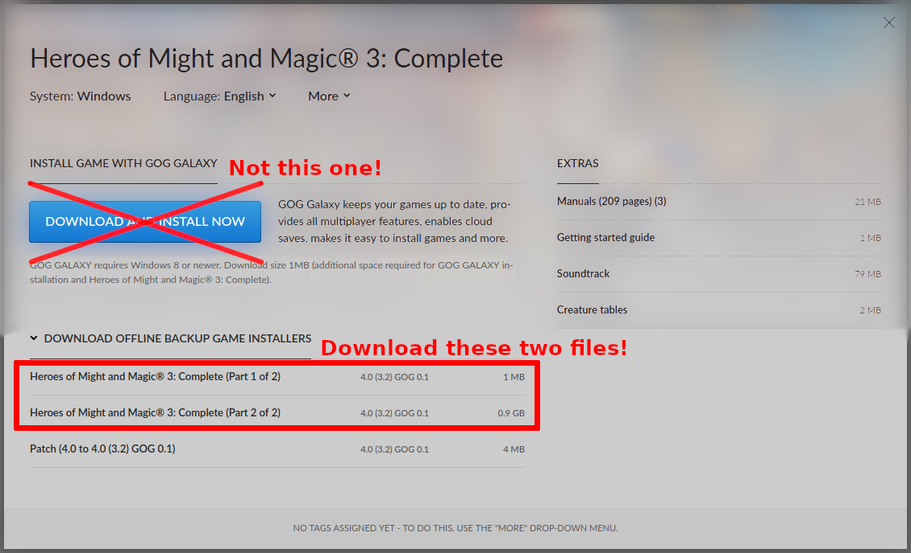

# Installation on Android

## Prerequisites

- Android 5.0 or newer is required.
- VCMI requires original *Heroes of Might and Magic III: Shadow of Death* or *Complete* data files.

## Step 1: Download and install VCMI

Install VCMI using one of the following options:

- **Google Play version (recommended):** [Google Play](https://play.google.com/store/apps/details?id=is.xyz.vcmi)
- **F-Droid**: [F-Droid](https://f-droid.org/en/packages/is.xyz.vcmi/)
- **APK from GitHub releases:** [GitHub Releases](https://github.com/vcmi/vcmi/releases/latest)
- **Development builds (unstable, for testing):**
  - install with [Obtainium](https://github.com/ImranR98/Obtainium): see below
  - install manually: [VCMI Builds](https://download.vcmi.eu/branch/develop/)

Install the app and start **VCMI**.

### Configuring Obtainium for automatic updates of development builds

1. Install [Obtainium](https://github.com/ImranR98/Obtainium) and open it
2. Tap **+ Add** button in the bottom right
3. Figure out which architecture your Android device is running on: arm64 (most likely, aka aarch64), x86_64 (Intel x64) or armv7 (armeabi-v7a, 32-bit)
4. Go to [VCMI Builds](https://download.vcmi.eu/branch/develop/), pick directory that starts with **android-** based on the architecture and copy its URL
5. Go back to Obtainium app and paste the URL into the first text field - **App source URL**
6. Enable options **Skip sorting** and **Take first link**
7. Tap **+** button on the right of the first text field - **App source URL**
8. Now you can open the VCMI entry and download/update the app

## Step 2: Obtain Heroes III data files

VCMI requires original *Heroes of Might and Magic III* data files.

### Option A (recommended): GOG offline installer

1. Download the **offline backup installer** from GOG.com.
2. The installer comes as two files:
   - `.exe`
   - `.bin`
3. Make sure both files are downloaded.

### Option B: Use existing Heroes III installation on PC

If you already have Heroes III installed on a PC, you can reuse those files.

## Step 3: Import Heroes III data into VCMI

Open **VCMI** on your device.

### A) Import from GOG installer

1. Select the option to import GOG files.
2. First select the `.exe` file.
3. Then select the matching `.bin` file when prompted.

VCMI will extract the required files.

### B) Import from PC installation

If you already have Heroes III installed on a PC:

1. Connect your device to the PC using a USB cable.
2. Enable file transfer mode on the device.
3. Copy these folders from the Heroes III installation:
   - `Data`
   - `Maps`
   - `Mp3`

   to any accessible folder on your device, for example: Downloads/Heroes3

4. Start VCMI Launcher.
5. Choose data import and select the folder where the files were copied.

## Step 4: Finish setup in Launcher

Follow the instructions in the Launcher to finish installation and optionally download recommended mods.

VCMI is now ready to play.
